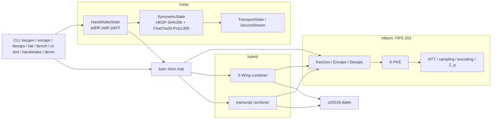

# hybridkem

> **Educational, not audited.** This is a study implementation of post-quantum key exchange.
> It has had no external review, its constant-time behaviour is checked only by code review
> and a statistical timing test, and it must not be used to protect real data. For
> production use a reviewed library such as RustCrypto's `ml-kem`/`x-wing`, aws-lc-rs or
> BoringSSL.

ML-KEM (FIPS 203) written from the standard in Rust, an X25519 + ML-KEM hybrid KEM (exact
X-Wing plus a transcript-hashing combiner for every parameter set), and a Noise-style
authenticated handshake built on those KEMs with ChaCha20-Poly1305 transport.

## Why

"Harvest now, decrypt later" is the reason TLS, SSH and messaging protocols are moving to
hybrid post-quantum key exchange today. Reading FIPS 203 is one thing; seeing how the NTT,
the Fujisaki-Okamoto transform, the hybrid combiner and a KEM-based handshake fit together
in about 4,600 lines of tested code (`scripts/loc.sh`: non-test lines under `src/`) is another. This repository is for:

- engineers who need to review or integrate ML-KEM and want a readable reference that maps
  one-to-one onto the algorithms in the standard;
- students of applied cryptography who want to see why KEM-based handshakes look different
  from Diffie-Hellman ones (PQNoise's `ekem`/`skem` tokens);
- anyone curious what the hybrid actually costs in bytes and microseconds.

## What is in it

| Component | Status | Evidence |
|---|---|---|
| ML-KEM-512/768/1024 (NTT, sampling, compression, K-PKE, FO transform with implicit rejection, FIPS 203 input checks) | from the spec | 243/243 pinned NIST ACVP vectors; byte-for-byte differential test vs RustCrypto `ml-kem` |
| X-Wing (X25519 + ML-KEM-768, draft-connolly-cfrg-xwing-kem-06) | exact | draft vectors 3/3; differential test vs RustCrypto `x-wing` |
| X25519 + ML-KEM-512/768/1024 with a transcript combiner | this project's construction | round-trip, tamper and low-order-point tests |
| Noise-style handshake: `pqNK`, `pqIK`, `pqXX`, any KEM | PQNoise-inspired | unit, property and TCP-loopback tests incl. tampering, replay, wrong keys |
| Constant-time hygiene | `subtle` select/compare, branch-free arithmetic, no hardware division on secrets | dudect-style timing test with a positive control |
| Benchmarks | per parameter set, hybrids, handshakes | Criterion + a one-command median table |

## Architecture



The handshake engine is generic over the `Kem` trait, so it runs unchanged over pure ML-KEM,
the hybrids or a classical X25519 baseline. Details, algorithms and complexity:
[docs/ARCHITECTURE.md](docs/ARCHITECTURE.md). Threat model:
[docs/THREAT_MODEL.md](docs/THREAT_MODEL.md).

## Quickstart

Developed and tested with Rust 1.97.1 (`rust-version` is set to 1.85, but older compilers were not tested). Everything runs offline.

```sh
make check        # fmt + clippy -D warnings + rustdoc + all tests under a >=80% coverage gate + vector checksums
make demo         # end-to-end demo (output below)
make bench-table  # median timings for every algorithm and handshake
make ct           # dudect-style timing-leak test (release build)
make bench        # Criterion benchmarks per parameter set
```

`make check` needs `cargo-llvm-cov` (`cargo install cargo-llvm-cov --locked`).

CLI examples:

```sh
cargo run --release -- keygen --alg xwing --out alice          # alice.sk (32-byte seed, hex), alice.pk
cargo run --release -- encaps --alg xwing --pk alice.pk --ct-out msg.ct
cargo run --release -- decaps --alg xwing --sk alice.sk --ct msg.ct
cargo run --release -- handshake --alg mlkem1024 --pattern xx  # two threads over TCP loopback
cargo run --release -- kat                                     # verify checksums, run all vectors
```

Algorithms: `mlkem512`, `mlkem768`, `mlkem1024`, `x25519`, `xwing`, `x25519-mlkem512`,
`x25519-mlkem768`, `x25519-mlkem1024`.

Library use:

```rust
use hybridkem::hybrid::XWing;
use hybridkem::noise::{Builder, Pattern, StaticKeypair};

let mut rng = rand::rng();
let server = StaticKeypair::<XWing>::generate(&mut rng);
let client = StaticKeypair::<XWing>::generate(&mut rng);

let mut i = Builder::new(Pattern::IK).local_static(client.clone())
    .remote_static(&server.public).build_initiator()?;
let mut r = Builder::new(Pattern::IK).local_static(server)
    .pin_peer(&client.public).build_responder()?;

let m1 = i.write_message(b"hello", &mut rng)?;
r.read_message(&m1)?;               // NOT sender-authenticated: forgeable from client.public
assert!(!r.peer_authenticated());
let m2 = r.write_message(b"", &mut rng)?;
i.read_message(&m2)?;
assert!(i.peer_authenticated());    // the server has proven its static key
let (mut tx, mut rx) = (i.into_transport()?, r.into_transport()?);
assert_eq!(rx.decrypt(&tx.encrypt(b"post-quantum")?)?, b"post-quantum");
assert!(rx.peer_authenticated());   // now the client has proven its static key
```

## Demo

Output of `make demo` (deterministic seed, so it reproduces exactly):

```text
hybridkem demo  (educational implementation, NOT audited; do not protect real data)
deterministic RNG seed 2026 so this output is reproducible

[1/5] Known-answer tests from pinned, checksummed vector files
  checksums: all files in vectors/SHA256SUMS verified
  suite              target       function                  result
  ACVP keyGen        ML-KEM-512   keyGen                     25/25
  ACVP keyGen        ML-KEM-768   keyGen                     25/25
  ACVP keyGen        ML-KEM-1024  keyGen                     25/25
  ACVP encapDecap    ML-KEM-512   encapsulation              25/25
  ACVP encapDecap    ML-KEM-768   encapsulation              25/25
  ACVP encapDecap    ML-KEM-1024  encapsulation              25/25
  ACVP encapDecap    ML-KEM-512   decapsulation              10/10
  ACVP encapDecap    ML-KEM-768   decapsulation              10/10
  ACVP encapDecap    ML-KEM-1024  decapsulation              10/10
  ACVP encapDecap    ML-KEM-512   decapsulationKeyCheck      10/10
  ACVP encapDecap    ML-KEM-512   encapsulationKeyCheck      10/10
  ACVP encapDecap    ML-KEM-768   decapsulationKeyCheck      10/10
  ACVP encapDecap    ML-KEM-768   encapsulationKeyCheck      10/10
  ACVP encapDecap    ML-KEM-1024  decapsulationKeyCheck      10/10
  ACVP encapDecap    ML-KEM-1024  encapsulationKeyCheck      10/10
  X-Wing draft-06    X-Wing       keygen+encaps+decaps         3/3
  total: 243/243 vectors passed

[2/5] ML-KEM (FIPS 203) at every parameter set
  ML-KEM-512  ek  800 B  dk 1632 B  ct  768 B  K df3f87e83e74f1f0..  agree=true  forged-ct K bd5aab5b18d2d2f1.. (implicit rejection)
  ML-KEM-768  ek 1184 B  dk 2400 B  ct 1088 B  K 39fb741986a1daeb..  agree=true  forged-ct K ae8e82544921db73.. (implicit rejection)
  ML-KEM-1024 ek 1568 B  dk 3168 B  ct 1568 B  K c56fcc2355a25d94..  agree=true  forged-ct K c8d0706f5082c4a9.. (implicit rejection)

[3/5] Hybrid X25519 + ML-KEM combiners
  same 32-byte seed and encapsulation randomness, two combiners over X25519 + ML-KEM-768:
    X-Wing      pk 1216 B  ct 1120 B  ss ec57dde2cb77e8c0..  decaps agrees=true
    transcript  pk 1216 B  ct 1120 B  ss 8770ace6bfbb2528..  decaps agrees=true
    identical ciphertexts=true, different secrets=true (combiners are domain-separated)

[4/5] Authenticated pqIK handshake over TCP loopback, X-Wing KEM, ChaCha20-Poly1305 transport
  protocol        HybridNoise_pqIK_X-Wing(X25519+ML-KEM-768)_ChaChaPoly_SHA256
  pattern
  <- s
  ...
  -> skem, e, s
  <- ekem, skem
  message sizes   [3584, 2303] bytes (total 5887 B over 127.0.0.1)
  handshake hash  c4da2866eb7a8f66..
  server static   fingerprint d5adf9022dfc04a8
  payload rcvd    "server: welcome"
  client -> "hello over a hybrid channel"  <- "server echo: hello over a hybrid channel"
  client -> "second message"  <- "server echo: second message"
  server saw      ["hello over a hybrid channel", "second message"]

[5/5] Active-attacker simulations (in memory, X-Wing pqIK)
  bit flip in message 1          -> rejected: authenticated decryption failed
  client pinned wrong server key -> rejected: authenticated decryption failed
  unpinned client static key     -> rejected: peer static key rejected by trust policy
  honest transport record        -> accepted
  replayed transport record      -> rejected: authenticated decryption failed

all sizes per algorithm (public key / ciphertext bytes):
  ML-KEM-512                           800 /   768  post-quantum
  ML-KEM-768                          1184 /  1088  post-quantum
  ML-KEM-1024                         1568 /  1568  post-quantum
  X25519                                32 /    32  classical only
  X-Wing(X25519+ML-KEM-768)           1216 /  1120  post-quantum
  transcript(X25519+ML-KEM-512)        832 /   800  post-quantum
  transcript(X25519+ML-KEM-768)       1216 /  1120  post-quantum
  transcript(X25519+ML-KEM-1024)      1600 /  1600  post-quantum
```

## Correctness evidence

| Check | Command | Result |
|---|---|---|
| NIST ACVP FIPS 203 vectors (keyGen 75, encapsulation 75, decapsulation 30, ek check 30, dk check 30) | `cargo run --release -- kat` | 240/240 |
| X-Wing draft-06 vectors | same | 3/3 |
| Vector integrity | `scripts/fetch-vectors.sh --verify-only` (also re-checked inside the tests) | 3 files match `vectors/SHA256SUMS` |
| Differential vs RustCrypto `ml-kem` 0.3.3: ek, expanded dk, ct, K, implicit-rejection K, modulus-check verdict | `cargo test --test crosscheck` | 64 random seeds x 3 parameter sets, all identical |
| Differential vs RustCrypto `x-wing` 0.1.1 | same | 64 random seeds, all identical |
| Exhaustive: Barrett reduction, `Compress`/`Decompress` for every input and `d` | `cargo test --lib` | pass |
| Property tests (NTT vs schoolbook, encode/decode, KEM round trip, single-bit tamper, garbage inputs, handshakes) | `cargo test` | pass |
| Line coverage (cargo-llvm-cov, all of `src/` incl. in-file unit-test modules) | `make coverage` | 98.19% lines, 97.36% functions, 96.27% regions (gate: 80% lines) |

Test counts from the last `make check`: 88 unit tests, 21 integration/property/CLI tests in `tests/`, 2 doctests, all passing (`make check` exit 0).

## Benchmarks

Apple M1 Pro (8 cores), macOS 26.6, rustc 1.97.1, release profile with thin LTO. The machine
was shared with other build jobs while measuring, so treat the numbers as indicative: medians for the same operation differed by up to about 20% between repeated runs.

Median of 2000 runs per operation (`make bench-table`, which runs
`cargo run --release -- bench --iters 2000`); "encaps" includes parsing and validating the
public key:

| algorithm | pk bytes | ct bytes | keygen µs | encaps µs | decaps µs |
|---|---:|---:|---:|---:|---:|
| ML-KEM-512 | 800 | 768 | 27.9 | 18.2 | 18.3 |
| ML-KEM-768 | 1184 | 1088 | 35.2 | 27.0 | 25.1 |
| ML-KEM-1024 | 1568 | 1568 | 55.7 | 41.5 | 33.9 |
| X25519 | 32 | 32 | 10.7 | 48.1 | 45.2 |
| X-Wing(X25519+ML-KEM-768) | 1216 | 1120 | 46.6 | 73.5 | 60.3 |
| transcript(X25519+ML-KEM-512) | 832 | 800 | 32.5 | 66.6 | 57.9 |
| transcript(X25519+ML-KEM-768) | 1216 | 1120 | 47.6 | 75.8 | 62.0 |
| transcript(X25519+ML-KEM-1024) | 1600 | 1600 | 66.6 | 86.5 | 70.2 |

| KEM | pattern | handshake bytes | full handshake µs |
|---|---|---:|---:|
| X25519 | pqIK | 240 | 297.2 |
| ML-KEM-768 | pqIK | 5712 | 232.9 |
| X-Wing(X25519+ML-KEM-768) | pqIK | 5872 | 487.2 |
| X-Wing(X25519+ML-KEM-768) | pqXX | 7120 | 481.9 |
| transcript(X25519+ML-KEM-1024) | pqIK | 8080 | 581.0 |

Criterion (`make bench`), per parameter set; the RustCrypto `ml-kem` crate is benchmarked in
the same run as a reference point only (median estimate):

| benchmark | ML-KEM-512 | ML-KEM-768 | ML-KEM-1024 |
|---|---:|---:|---:|
| keygen (from seed) | 19.8 µs | 31.3 µs | 55.3 µs |
| encaps, including `ek` parse + modulus check + `A-hat` expansion | 20.5 µs | 28.0 µs | 41.2 µs |
| encaps, pre-parsed `ek` | 13.0 µs | 18.3 µs | 23.8 µs |
| decaps (this crate) | 35.8 µs | 26.1 µs | 38.9 µs |
| decaps (RustCrypto `ml-kem` 0.3.3, reference) | 19.4 µs | 22.0 µs | 32.4 µs |

Hybrids and handshake in the same run: X-Wing encaps 68.8 µs, X-Wing decaps 62.3 µs,
X25519+ML-KEM-1024 (transcript) decaps 73.0 µs, full pqIK handshake with X-Wing (both sides,
in memory) 530 µs. Criterion flagged high outliers in several groups and the ML-KEM-512 and
ML-KEM-1024 decaps intervals are wide (30.0-42.2 µs and 34.9-47.2 µs); the 768 numbers have
the tightest intervals.

What the numbers say: this implementation is a readable reference, roughly
1.2-1.8x slower than the optimized `ml-kem` crate on decapsulation (canonical-form
arithmetic and heap-allocated vectors, see [DECISIONS.md](DECISIONS.md)). The post-quantum
cost on the wire is large compared with X25519 (a pqIK handshake grows from 240 bytes to
about 5.9 KB with X-Wing) while the CPU cost stays well under a millisecond.

## Constant-time evidence

`make ct` runs a dudect-style test (`cargo run --release -- ct-test --samples 100000`):
classes are interleaved at random, every call is timed, and Welch's t-test is applied to the
raw and percentile-cropped distributions. |t| < 4.5 means no leak was detected at that sample
size; |t| >= 10 is a leak. The last row is a deliberately leaky early-exit comparison included
to prove the harness can see a leak on this machine.

```text
target                                  samples median ns 0/1  max |t|  verdict
mlkem768-decaps-valid-vs-invalid         100000   25333/25333     2.50  no leak detected
mlkem768-decaps-msg-zero-vs-random       100000   25209/25209     4.96  inconclusive
xwing-decaps-valid-vs-invalid            100000   60625/60625     3.84  no leak detected
subtle-ct-eq-1088B                       100000   30750/30750     1.80  no leak detected
naive-eq-1088B (positive control)        100000      2041/125  7739.81  LEAK (expected: control must leak)

|t| < 4.5: no leak detected at this sample size; |t| >= 10: leak. A pass is evidence, not proof.
```

Two findings from building this, both recorded in [DECISIONS.md](DECISIONS.md):

- **`mlkem768-decaps-msg-zero-vs-random` is inconclusive, not a pass.** Across runs it gave
  |t| 1.6-5.0 at 100k samples and 6.3-8.5 at 400k samples (three seeds), so |t| rises with
  sample count but stays below 10. Because ML-KEM encapsulation is deterministic in `m`, class 0
  is a single fixed ciphertext. A control in which the fixed ciphertext encrypts a *random*
  message showed the same magnitude (|t| 3.4-5.6 vs 4.1-5.1 for m = 0, 400k samples), which
  suggests the effect comes from repeating one input rather than from the message value. That
  is a hypothesis, not a proof.
- **The harness itself produced a false positive at first.** The `subtle` comparison target
  initially reported |t| 27-126 because its two classes used two different heap buffers. The
  disassembly showed a branch-free `ldrb/cmp/cset/and` loop, and using one buffer for both
  classes dropped |t| to 1.7-2.6 while the leaky control stayed above 6,600. Memory layout
  can fake a leak, and could also hide one.

This is evidence, not proof: it covers one CPU, one compiler version and the input classes
chosen, and it cannot see leaks smaller than the clock and noise floor.

## Design decisions (summary)

Full log with costs in [DECISIONS.md](DECISIONS.md).

- **From the spec, readable first**: canonical `[0, q)` coefficients with Barrett reduction,
  compile-time twiddle tables, one module per FIPS 203 section.
- **No division on secrets**: `Compress_d` uses a reciprocal multiply (the KyberSlash lesson),
  exhaustively tested.
- **Implicit rejection via `subtle`**: both keys are always computed; the selection is
  `conditional_assign`, never a branch.
- **Two combiners**: exact X-Wing for interop and vectors; a transcript combiner that binds
  `H(ct_M)` and `H(ek_M)` so it does not rely on ML-KEM's ciphertext-binding property and
  works for 512/768/1024.
- **KEM-native handshake**: PQNoise-style `ekem`/`skem` tokens over Noise's symmetric core,
  named `HybridNoise_*` so it is never mistaken for a registered Noise protocol.
- **Vectors pinned and checksummed**: committed for offline tests, re-fetchable from pinned
  upstream commits, and re-hashed by the test harness before use.

## Limitations

- **Not audited, no security proof** for the transcript combiner or the handshake token
  rules; they are this project's constructions. Not interoperable with any other Noise or
  PQNoise implementation.
- **Constant time is checked statistically on one machine** (Apple M1 Pro), and one target
  (fixed-vs-random decapsulation) is *inconclusive* at 400k samples (see above). No analysis of
  generated assembly, no cache/power/EM side-channel analysis. `u64` multiplication is
  assumed constant time (not true on all 32-bit targets).
- **Zeroization is best-effort**: secret types wipe on drop, but the compiler may leave copies
  on the stack or in registers.
- **Performance** is about 1.2-1.8x slower (Criterion, same run) than an optimized implementation on decapsulation; no SIMD, no
  Montgomery/lazy reduction.
- **Responder-side handshake payloads are not sender-authenticated.** Anyone who knows a
  client's *public* key can forge a pqIK message 1 (or pqXX message 3) with any payload, and a
  responder that pinned that client accepts it; the forger cannot complete the handshake.
  KEM tokens give no way to authenticate message 1 the way Noise IK's `ss` does. Act on such
  payloads only once `peer_authenticated()` is true (for the responder: after the first
  transport message decrypts). See the threat model.
- **First-message (0-RTT) payloads** in pqIK/pqNK lack forward secrecy and are replayable;
  `pqXX` without a verifier only resists passive attackers (see the threat model).
- **Coverage figure includes in-file unit-test code**, which `cargo-llvm-cov` cannot exclude
  on stable; per-file numbers are in the report.
- **Benchmarks were taken on a shared machine** with other jobs running; Criterion reported
  outliers on several runs.
- The C2SP "accumulated" vectors are not used (they target the FIPS 203 draft, not the
  final standard); random coverage comes from the differential test instead.
- CI (`.github/workflows/ci.yml`) is written but has not run, because the repository has not
  been pushed.

## Roadmap

- Montgomery-form arithmetic and an AVX2/NEON NTT, measured against this baseline.
- Update X-Wing to the published RFC once CFRG settles the non-contributory check.
- `pqKK` and PSK patterns; a symbolic check of the handshake (e.g. Tamarin) before trusting
  the token rules.
- Second-order dudect statistics and a Valgrind/`ctgrind`-style secret-taint check.
- Interop tests against another PQ handshake implementation.

## References

- NIST FIPS 203, *Module-Lattice-Based Key-Encapsulation Mechanism Standard* (2024).
- D. Connolly et al., *X-Wing: general-purpose hybrid post-quantum KEM*, draft-connolly-cfrg-xwing-kem-06; M. Barbosa et al., *X-Wing: The Hybrid KEM You've Been Looking For* (2024).
- Y. Angel, B. Dowling, A. Hülsing, P. Schwabe, F. Weber, *Post Quantum Noise*, ACM CCS 2022.
- T. Perrin, *The Noise Protocol Framework*, revision 34.
- O. Reparaz, J. Balasch, I. Verbauwhede, *Dude, is my code constant time?*, DATE 2017.
- NIST ACVP-Server ML-KEM vectors: <https://github.com/usnistgov/ACVP-Server>.

## License

MIT, see [LICENSE](LICENSE). Test vectors keep their upstream terms; see [DATA.md](DATA.md).
