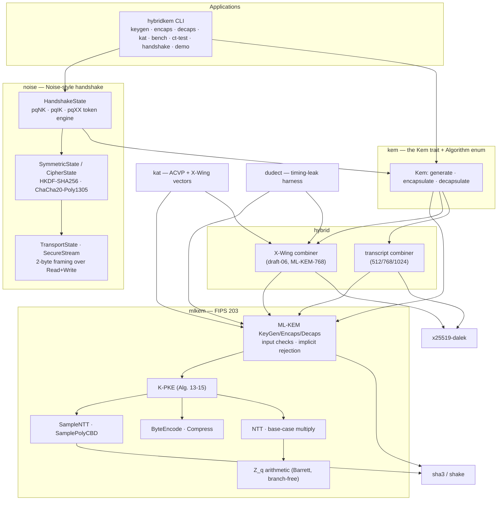

# Architecture

> Educational, not audited. See [THREAT_MODEL.md](THREAT_MODEL.md) for what that means.

## Layers



The handshake engine and the CLI see only bytes and the `Kem` trait, so the same code runs
over pure ML-KEM, the hybrids, or the classical X25519 baseline (useful for size and speed
comparisons).

## Module map

| Path | Responsibility |
|---|---|
| `src/mlkem/field.rs` | `Z_3329` add/sub/mul, Barrett reduction, branch-free conditional subtraction, compile-time `pow_mod`, `BitRev7` |
| `src/mlkem/poly.rs` | `Poly` type, forward/inverse NTT (Alg. 9-10), `MultiplyNTTs`/`BaseCaseMultiply` (Alg. 11-12), compile-time twiddle tables |
| `src/mlkem/encode.rs` | `ByteEncode_d`/`ByteDecode_d` (Alg. 5-6), the modulus check, `Compress_d`/`Decompress_d` |
| `src/mlkem/sample.rs` | `SampleNTT` rejection sampling (Alg. 7), `SamplePolyCBD_eta` (Alg. 8) |
| `src/mlkem/hash.rs` | `H`, `J`, `G`, `PRF`, `XOF` framing over SHA-3/SHAKE |
| `src/mlkem/kpke.rs` | K-PKE key generation, encryption, decryption (Alg. 13-15) |
| `src/mlkem/params.rs` | sealed `ParameterSet` trait, the three parameter sets, derived sizes |
| `src/mlkem/mod.rs` | public `EncapsulationKey`/`DecapsulationKey`/`Ciphertext`, FO transform with implicit rejection (Alg. 16-21) |
| `src/hybrid.rs` | `HybridKem<P, C>`, `XWingCombiner`, `TranscriptCombiner`, key/ciphertext layouts |
| `src/kem.rs` | `Kem` trait implemented by every parameter set, every hybrid and `X25519Kem`; `Algorithm` runtime selection and the `with_kem!` dispatch macro |
| `src/noise/cipher.rs` | Noise `CipherState`, `SymmetricState`, `HKDF`, `Split`, rekey |
| `src/noise/pattern.rs` | `Token` (`e`, `s`, `ekem`, `skem`), `Pattern` (`pqNK`, `pqIK`, `pqXX`), notation rendering |
| `src/noise/handshake.rs` | `Builder`, `HandshakeState` token interpreter, pinning/verifier policy |
| `src/noise/transport.rs` | `TransportState` (per-direction ciphers, size limits, rekey) |
| `src/noise/stream.rs` | frame I/O, `run_handshake`, `SecureStream` |
| `src/kat.rs` | ACVP and X-Wing vector runners, checksum verification |
| `src/dudect.rs` | Welford statistics, Welch's t, crop ladder, measurement loop, built-in targets |
| `src/bench.rs` | median-of-N timing for the CLI table |
| `src/cli/*` | argument parsing, file I/O, report formatting, the demo |

## Key algorithms

### Field arithmetic

Coefficients live in `[0, q)` as `u16`. Products of two canonical values are below `2^24`;
`reduce` computes `x - floor(x * m / 2^32) * q` with `m = floor(2^32 / q)`. The approximation
error is below one for every `x < 2^26`, so the result lies in `[0, 2q)` and one masked
subtraction (`csubq`) finishes. `csubq` derives an all-ones/all-zeros mask from the sign bit
of `x - q`; there is no comparison or branch. Both claims are tested exhaustively on
`[0, 2^20)` and on a stride through the rest of the domain.

### NTT

`q - 1 = 3328 = 2^8 * 13`, so `Z_q` has primitive 256th roots of unity but not 512th:
`X^256 + 1` splits into 128 quadratics `X^2 - zeta^(2 BitRev7(i) + 1)`. The forward
transform is 7 layers of Cooley-Tukey butterflies (128 per layer) using
`ZETAS[i] = 17^BitRev7(i)`; the inverse runs Gentleman-Sande butterflies in reverse and
multiplies by `128^-1 = 3303`. Products in the NTT domain are 128 independent
degree-one multiplications modulo `X^2 - gamma_i` (`BaseCaseMultiply`). Both tables are
`const` evaluated at compile time from `pow_mod`, so there is no hand-copied table to get
wrong; the first entries are asserted against FIPS 203 Appendix A, and property tests check
NTT round trips and NTT-multiplication against schoolbook negacyclic convolution.

### Sampling and encoding

`SampleNTT` parses 3-byte groups of SHAKE128 output into two 12-bit candidates and keeps
those below `q` (expected ~19% rejection). `SamplePolyCBD_eta` takes the difference of two
`eta`-bit popcounts per coefficient. `ByteEncode_d` packs little-endian bitstreams with a
32-bit accumulator. `Compress_d(x) = round(2^d x / q)` is computed as
`((x << d) + 1664) * ceil(2^35 / q) >> 35`, exact for all numerators below `2^23`
(exhaustively tested), avoiding the hardware divider.

### ML-KEM and the FO transform

```
KeyGen(d, z):    (rho, sigma) = G(d || k)
                 A[i][j] = SampleNTT(rho || j || i);  s, e <- CBD_eta1(PRF(sigma, N++))
                 t = A s + e  (NTT domain);  ek = Enc12(t) || rho
                 dk = Enc12(s) || ek || H(ek) || z
Encaps(ek, m):   (K, r) = G(m || H(ek));  c = K-PKE.Encrypt(ek, m, r)
Decaps(dk, c):   m' = K-PKE.Decrypt(s, c);  (K', r') = G(m' || h)
                 K_bar = J(z || c);  c' = K-PKE.Encrypt(ek, m', r')
                 return  CT-select(c == c', K', K_bar)
```

The last line is `subtle::ConstantTimeEq` over the whole ciphertext followed by
`ConditionallySelectable::conditional_assign` on the 32-byte key: both keys are always
computed and the comparison result never becomes a branch or an early exit.

### Hybrid combiners

```
X-Wing:      ss = SHA3-256(ss_M || ss_X || ct_X || pk_X || "\.//^\")
transcript:  ss = SHA3-256(len || "hybridkem/X25519+ML-KEM-<n>/v1" || ss_M || ss_X
                           || SHA3-256(ct_M) || ct_X || H(ek_M) || pk_X)
```

Secret keys are a 32-byte seed; `SHAKE256(seed, 96)` yields the ML-KEM `d || z` and the
X25519 scalar. Public keys are `ek_M || pk_X`, ciphertexts `ct_M || ct_X`, and the
encapsulation randomness `eseed = m || ek_X` (64 bytes).

### Handshake

`SymmetricState` starts from `h = ck = protocol_name` (hashed if longer than 32 bytes),
mixes the prologue and pre-messages, then interprets tokens:

| token | writer | reader |
|---|---|---|
| `e` | fresh KEM key pair; send `pk`; `MixHash(pk)` | `re = pk`; `MixHash(re)` |
| `s` | send `EncryptAndHash(s.pk)` | `rs = DecryptAndHash(..)`; pin / verifier check |
| `ekem` | `(ct, ss) = Encaps(re)`; send `EncryptAndHash(ct)`; `MixKey(ss)` | `MixKey(Decaps(e, DecryptAndHash(..)))` |
| `skem` | `(ct, ss) = Encaps(rs)`; send `EncryptAndHash(ct)`; `MixKey(ss)` | `MixKey(Decaps(s, DecryptAndHash(..)))` |

```
pqNK:  <- s ... -> skem, e          <- ekem
pqIK:  <- s ... -> skem, e, s       <- ekem, skem
pqXX:           -> e   <- ekem, s   -> skem, s   <- skem
```

After the last message `Split()` derives one ChaCha20-Poly1305 key per direction; nonces
are 64-bit counters encoded as `0^32 || LE64(n)`, with `2^64 - 1` reserved for `Rekey`.

## Complexity

Let `n = 256`, `k` the module rank (2, 3, 4) and `T_ntt = O(n log n)` (7 x 128 butterflies).

| Operation | Time | Notes |
|---|---|---|
| NTT / inverse NTT | `O(n log n)` | 896 butterflies, fixed |
| `MultiplyNTTs` | `O(n)` | 128 base-case products |
| `SampleNTT` | `O(n)` expected | ~3.5 SHAKE128 blocks per polynomial, data-dependent (public input) |
| KeyGen | `O(k^2 n + k n log n)` | `k^2` SampleNTT + matrix-vector product, `2k` NTTs |
| Encaps (pre-parsed key) | `O(k^2 n + k n log n)` | `A-hat` is cached, so only the `k^2` base-case products remain |
| Decaps | Encaps + `O(k n log n)` | decrypt, then re-encrypt for the FO check |
| Parsing an `ek` | `O(k^2 n)` | modulus check + `A-hat` expansion |
| Hybrid ops | ML-KEM op + one X25519 scalar multiplication + one SHA3-256 | transcript combiner also hashes `ct_M` |
| Handshake | `O(#KEM ops)` | pqIK: initiator 1 keygen + 1 encaps + 2 decaps; responder 2 encaps + 1 decaps (each encaps re-parses the peer key, including `A-hat` expansion) |

Space: a parsed ML-KEM-768 encapsulation key holds `t-hat` (3 x 512 B) plus `A-hat`
(9 x 512 B) = 6 KiB; a decapsulation key adds `s-hat` (1.5 KiB). Handshake state is a few
KiB dominated by the peer's public keys. All operations are constant-size; nothing grows
with message count except the 64-bit nonce counters.

## Constant-time hygiene checklist

| Location | Secret input | Treatment |
|---|---|---|
| `field::csubq`, `field::reduce` | coefficients | mask arithmetic, Barrett multiply-shift |
| `encode::compress` | `u`, `v`, `w` coefficients | reciprocal multiplication, no `/` |
| `sample::sample_poly_cbd` | PRF output | shifts and masks, fixed loops |
| `poly::ntt`, `inv_ntt`, `multiply_ntt` | secret polynomials | fixed loop bounds, table indices depend only on loop counters |
| `kpke::decrypt` | `s-hat`, message bits | fixed loops; `Compress_1` as above |
| `mlkem::DecapsulationKey::decapsulate` | `c == c'` result, both candidate keys | `subtle` comparison and selection |
| `secret::SharedSecret::eq` | shared secrets | `subtle::ConstantTimeEq` |
| `SampleNTT` loop | `rho` | data-dependent, but `rho` is public |
| `HybridEncapsulationKey` non-contributory check | X25519 output | depends only on whether the public point has low order |

The `dudect` module tests the decapsulation paths empirically; see the README for results.
